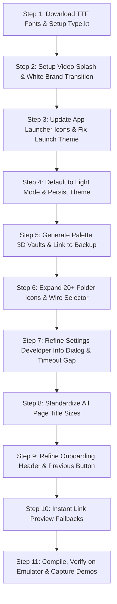

# Clippr UI & Feature Redesign V2 Implementation Plan

> [!IMPORTANT]
> This plan addresses all 12 user feedback points from manual testing, preserving Clippr's zero-cloud, encrypted local-first foundation while elevating its aesthetics, startup flow, font customization, and feature depth.

---

## 1. Dynamic Font Engine with Instant Switching

### Objectives
- Keep current **Plus Jakarta Sans / DM Sans** as default.
- Support instant switching to creative fonts:
  1. **Shadows Into Light** (Playful, hand-drawn)
  2. **Dancing Script** (Fluid, elegant cursive)
  3. **Allura** (Refined, delicate script)
  4. **Alkatra** (Bold, artistic display)
- Apply the chosen font family across **all typography levels** (Display, Titles, Body, Chips, Buttons).
- Changes must apply **instantly across the entire app** without restarting.

### Implementation Steps
1. Download official `.ttf` files directly into `app/src/main/res/font/`:
   - `shadows_into_light.ttf`
   - `dancing_script.ttf`
   - `allura.ttf`
   - `alkatra.ttf`
   - `plus_jakarta_sans.ttf`
2. Update `Type.kt`:
   - Define `FontFamily` instances for each font.
   - Refactor `createClipprTypography(fontName)` to map the active font to every single `TextStyle` (Display, Headline, Title, Body, Label).
3. Connect `PreferencesManager.selectedFont` to `ClipprTheme` in `MainActivity.kt` and `AppearanceScreen.kt` for live, reactive updates.

---

## 2. Settings: Developer Section Redesign

### Objectives
- Do **not** display developer email or raw details directly on the main Settings screen.
- Provide a clean, interactive **"Developer info"** row.
- Tapping opens a bottom sheet or dialog containing:
  - Studio Name: **Code Vampires, India**
  - Email: **codevampires@gmail.com**
  - Interactive Feedback input box with a **"Send Feedback"** action routing to Google Play Store.

### Implementation Steps
1. In `SettingsScreen.kt`:
   - Replace the inline developer info card with a standard settings row: icon, "Developer info", subtitle "About the team & feedback", and a chevron.
2. Build `DeveloperInfoBottomSheet` / dialog:
   - Displays Code Vampires logo/avatar, location, support email with one-tap copy, and the feedback submission box.

---

## 3. Expanded Library of 20+ Category Folder Icons

### Objectives
- Provide at least 20 distinct, useful category vector icons for folders (including YouTube, Reels, TikTok, etc.).

### Icon Catalog
| # | Category | Icon / Resource |
|---|---|---|
| 1 | **YouTube** | `ic_folder_youtube` |
| 2 | **Reels / Instagram** | `ic_folder_instagram` |
| 3 | **TikTok / Short Video** | `ic_folder_tiktok` |
| 4 | **Twitter / X** | `ic_folder_twitter` |
| 5 | **LinkedIn** | `ic_folder_linkedin` |
| 6 | **Chrome / Web** | `ic_folder_chrome` |
| 7 | **Reddit** | `ic_folder_reddit` |
| 8 | **GitHub / Code** | `ic_folder_github` |
| 9 | **Spotify / Music** | `ic_folder_music` |
| 10 | **News / Articles** | `ic_folder_news` |
| 11 | **Books / Reading** | `ic_book_open` |
| 12 | **Design / Art** | `ic_palette` |
| 13 | **Food / Recipes** | `ic_utensils` |
| 14 | **Travel / Places** | `ic_plane` |
| 15 | **Fashion / Style** | `ic_fashion` |
| 16 | **Education / Study** | `ic_education` |
| 17 | **Finance / Money** | `ic_folder_finance` |
| 18 | **Health / Fitness** | `ic_folder_fitness` |
| 19 | **Work / Projects** | `ic_briefcase` |
| 20 | **Ideas / Sparkles** | `ic_sparkles` |
| 21 | **Photography / Camera** | `ic_folder_camera` |
| 22 | **Shopping / Wishlist** | `ic_folder_shopping` |

### Implementation Steps
1. Add any missing XML vector assets to `app/src/main/res/drawable/`.
2. Expand `getFolderIconRes` mapping in `FolderCard.kt`.
3. Update `FoldersScreen.kt` folder creation sheet with a categorized or searchable icon selector grid.

---

## 4. Palette-Adaptive 3D Claymorphic Vault Images

### Objectives
- Generate high-quality 3D claymorphic vault visuals customized for each Light theme color palette:
  - **Emerald** (Accent `#87B69D` / `#49745F`)
  - **Forest** (Deep Pine `#2D5A43`)
  - **Sand** (Warm Terracotta / Desert `#D97757`)
  - **Sage** (Soft Olive `#7E9F88`)
  - **Lavender** (Pastel Violet `#9A86C4`)
  - **Amber** (Golden Ochre `#D49B44`)
- When the user selects a palette in Appearance settings, the Backup & Restore hero illustration immediately updates to match that color.

### Implementation Steps
1. Generate the 6 palette-specific 3D claymorphic vault images.
2. Save into `app/src/main/res/drawable/`:
   - `backup_hero_emerald.jpg`
   - `backup_hero_forest.jpg`
   - `backup_hero_sand.jpg`
   - `backup_hero_sage.jpg`
   - `backup_hero_lavender.jpg`
   - `backup_hero_amber.jpg`
3. In `BackupRestoreScreen.kt`, resolve the drawable dynamically using `LocalClipprPalette` or `preferencesManager.selectedPalette`.

---

## 5. Instant Link Previews for Every Link

### Objectives
- Ensure **every link** has an immediate, visually engaging preview thumbnail with zero loading lag.

### Implementation Steps
1. Enhance `LinkCard.kt` and `LinkDetailScreen.kt`:
   - If a link has a scraped `previewImagePath`, load it via Coil disk cache.
   - If the image is null, empty, or fails to load, immediately render an elegant, styled fallback:
     - Gradient surface matched to the link's category/domain.
     - Domain favicon / platform icon badge (YouTube, Twitter, GitHub, etc.).
     - Large monogram or subtle editorial pattern.
2. Seed mock data links with local pre-bundled image drawables so sample links render instantly on first launch.

---

## 6. Fix App Lock Timeout Option Spacing

### Objectives
- Eliminate the awkward vertical gap between App Lock timeout options in `SettingsScreen.kt`.

### Implementation Steps
1. In `SettingsScreen.kt`, redesign the timeout choices (**Immediately**, **1 min**, **5 min**, **15 min**) into a sleek horizontal segmented control / pill row.
2. Ensure consistent 8dp spacing, clear active highlight, and compact card padding.

---

## 7. Harmonize All Page Title Font Sizes

### Objectives
- Ensure all screen headers share identical title styling. Currently, Folders screen title is smaller than Home.

### Implementation Steps
1. Audit and standardize the TopBar title style across:
   - `HomeScreen.kt` ("Clippr")
   - `FoldersScreen.kt` ("Folders")
   - `FavoritesScreen.kt` ("Favorites")
   - `SettingsScreen.kt` ("Settings")
   - `SearchScreen.kt` ("Search")
   - `TrashScreen.kt` ("Trash")
   - `BackupRestoreScreen.kt` ("Backup & Restore")
2. Use unified typography: `fontSize = 24.sp`, `fontWeight = FontWeight.Bold`, `letterSpacing = (-0.4).sp`, and consistent status bar padding.

---

## 8. Cold Start Fix & App Icon Update

### Objectives
- Remove the Android cold-start black screen with a green dot.
- Update the Android launcher icon with the 3D meditating paperclip mascot logo.
- Smooth transition: System launch -> Video splash -> White splash info screen -> Home/Onboarding.

### Implementation Steps
1. Generate `ic_launcher.png`, `ic_launcher_round.png`, and adaptive foreground icons using the provided meditating mascot image.
2. Configure Android 12 Splash Screen API in `values/themes.xml` and `values-v31/themes.xml`:
   - `windowSplashScreenBackground`: `#FFFFFF`
   - `windowSplashScreenAnimatedIcon`: `@drawable/ic_launcher_foreground`
   - `postSplashScreenTheme`: `@style/Theme.Clippr`
   This eliminates the black screen and green dot entirely.

---

## 9. Clean Onboarding Header (No Mascot Icon)

### Objectives
- In the onboarding screen header, remove the mascot icon and show only the clean text title **"Clippr"**.

### Implementation Steps
1. In `OnboardingScreen.kt` header row, remove the 34dp mascot image container.
2. Display only `Text(text = "Clippr", style = ClipprTheme.typography.titleLarge)`.

---

## 10. Video Splash Screen + White Info Transition Screen

### Objectives
- Use the user's video: `Clippr/Paperclip_character_launches_int._1080p_20260928230753.mp4`.
- On cold launch:
  1. Play the video splash smoothly (full-bleed, muted or audio-ready).
  2. Upon video completion, crossfade smoothly into a clean **white screen** displaying:
     - 3D Meditating Mascot logo
     - App Title: **Clippr**
     - Tagline: **"Yours. Local. Always."**
     - Small subtitle/description
     - 4-segment animated loading bar
  3. When loading bar completes:
     - First-time user -> Navigates to Onboarding flow.
     - Returning user -> Navigates to Home screen.

### Implementation Steps
1. Copy video to `app/src/main/res/raw/splash_launch_video.mp4`.
2. Update `AnimatedSplashScreen.kt`:
   - Stage 1: Android `VideoView` / `ExoPlayer` playing `splash_launch_video.mp4`.
   - Stage 2: White background screen with Mascot, Title, Tagline ("Yours. Local. Always."), and the 4-segment progress bar.
   - Stage 3: Smooth callback to trigger next screen.

---

## 11. Refined Onboarding ("Welcome to Clippr") + "Previous" Button

### Objectives
- Replace the awkward "App uses" phrasing with polished, editorial welcoming headlines.
- Add a **"Previous"** button on steps 2, 3, and 4 so users can navigate backwards.
- Provide alternative presentation style options for user approval.

### Implementation Steps
1. In `OnboardingScreen.kt`, add a **"Previous"** button in the bottom navigation row when `currentPage > 0`.
2. Refactor step headings and copy:
   - **Step 1**: *"Save from Anywhere"* — Save links from Chrome, YouTube, X, or any app in one tap.
   - **Step 2**: *"Smart Local Tagging"* — Organize with auto-detected categories, metadata, and custom tags.
   - **Step 3**: *"Spaces & Collections"* — Group related reading lists, projects, and inspirations neatly.
   - **Step 4**: *"Distraction-Free Reading"* — Clean reader mode with progress indicator and zero tracking.

---

## 12. Default to Light Mode

### Objectives
- Ensure the app opens in **Light mode** by default on a fresh install.
- Respect and persist manual user switches to Dark mode in `PreferencesManager`.

### Implementation Steps
1. Add `isDarkMode` state flow in `PreferencesManager.kt` with default value `false`.
2. In `MainActivity.kt`, observe `isDarkMode` from preferences instead of hardcoding `true`.
3. In `SettingsScreen.kt` and `AppearanceScreen.kt`, bind the theme toggle directly to `preferencesManager.setDarkMode(...)`.

---

## Execution Order

