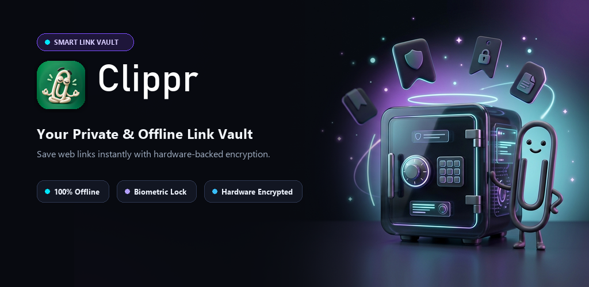
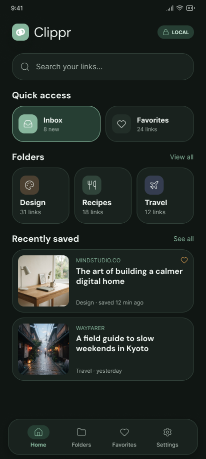
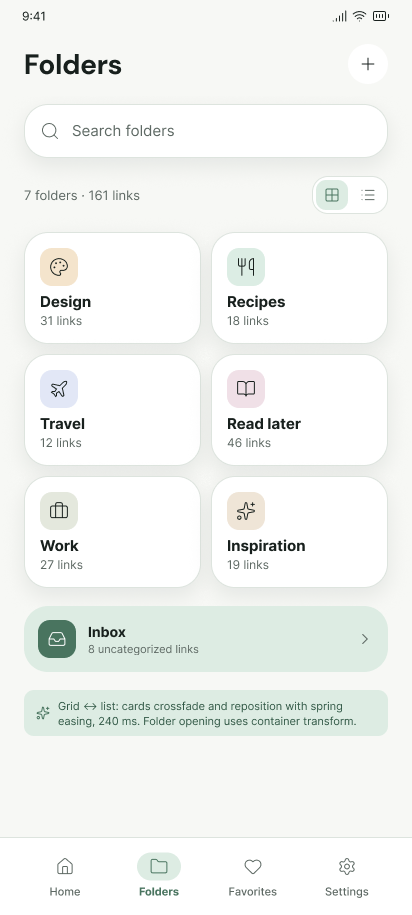
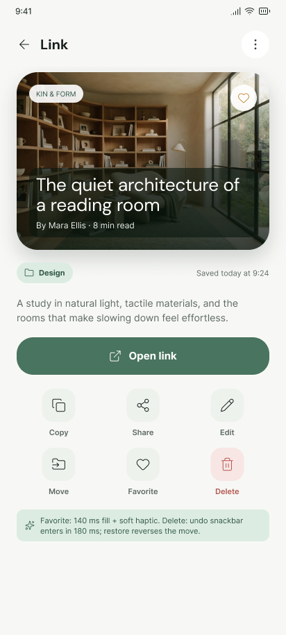
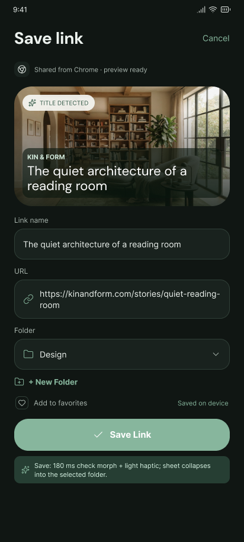
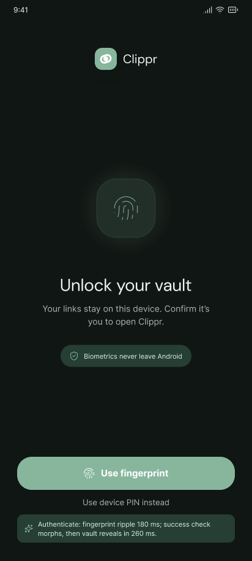
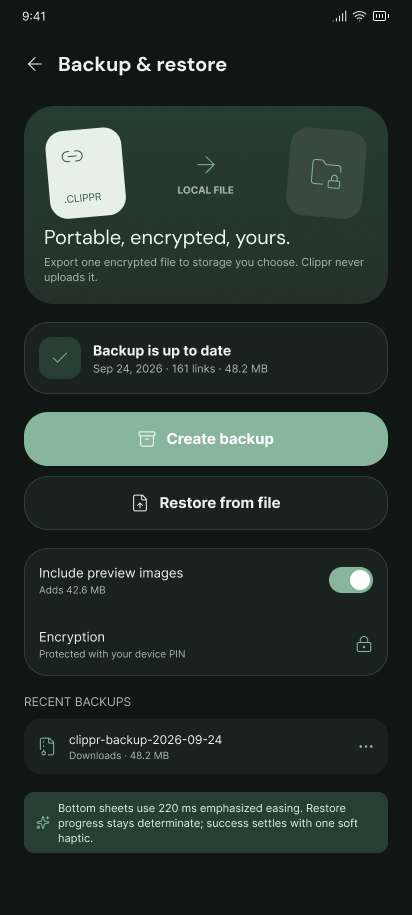

<p align="center">
  
</p>

<p align="center">
  
</p>

<h1 align="center">Clippr — Smart Link Vault</h1>

<p align="center">
  <strong>Your Private, 100% Offline & Biometrically Secured Bookmark Vault for Android</strong>
</p>

<p align="center">
  <a href="https://android.com"></a>
  <a href="https://kotlinlang.org"></a>
  <a href="https://developer.android.com/jetpack/compose"></a>
  <a href="https://clipprvault.web.app"></a>
  <a href="https://clipprvault.web.app"></a>
  
</p>

---

## 📖 Overview

**Clippr** (`com.clipprvault.app`) is a privacy-first, local-first link vault and bookmark manager for Android. Built entirely with Kotlin, Jetpack Compose, and Material 3, Clippr provides a fast and secure repository for links captured directly from the native Android Sharesheet (`ACTION_SEND` and `ACTION_PROCESS_TEXT`).

Unlike traditional bookmarking tools, **Clippr operates 100% on-device**:
- **Zero Cloud Accounts:** No sign-up, email, or passwords required.
- **Zero Telemetry or Ads:** No analytics, trackers, or commercial SDKs.
- **Hardware-Backed Encryption:** Your vault backups are sealed using AES-256-GCM via the Android Keystore.

---

## 📸 Snapshots & Interface

<div align="center">

| Home & Vault Feed | Folders & Collections | Link Reader & Preview |
|:---:|:---:|:---:|
|  |  |  |

| Instant Native Sharesheet | Biometric App Lock | Encrypted Backup & Restore |
|:---:|:---:|:---:|
|  |  |  |

</div>

---

## ✨ Key Features

- **⚡ Instant Sharesheet Integration:** Share links from Chrome, Twitter/X, Reddit, or YouTube directly to Clippr without interrupting your browsing flow.
- **🔒 Biometric Security (AppLock):** Protect your vault with fingerprint, face unlock, or device PIN using Android's hardware `BiometricPrompt`.
- **🏷️ Flexible Organization:** Organize links with custom folders, folder colors, icons, smart tags, favorites, and full-text search.
- **📑 Offline Metadata Caching:** Automatically extracts OpenGraph title, description, and preview imagery for offline viewing.
- **📦 Encrypted Vault Backup (.clippr):** Export and restore your complete vault with password-protected AES-256-GCM encryption.
- **🎨 Modern Dark & Light Aesthetics:** Clean glassmorphism, fluid micro-animations, and dynamic theme switching.

---

## 🛠️ Technology Stack & Architecture

- **UI Framework:** [Jetpack Compose](https://developer.android.com/jetpack/compose) with Material 3 Design System
- **Local Persistence:** [Room Database](https://developer.android.com/training/data-storage/room) (SQLite) with KSP
- **Security:** Android Keystore Provider, `androidx.biometric:biometric`, AES-256-GCM
- **Networking & Metadata:** OkHttp, Jsoup (HTML/OpenGraph parser), Coil (Image loading)
- **Architecture:** Clean Architecture + MVI/MVVM pattern with Kotlin Coroutines & StateFlow

---

## 🚀 Building & Running

### Prerequisites
- Android Studio Ladybug / Meerkat or later
- JDK 17
- Android SDK 36 (Android 16) / minSdk 26

### Debug Build
```bash
./gradlew assembleDebug
```

### Production Release Bundle (AAB)
```bash
./gradlew bundleRelease
```
The signed `.aab` file will be generated at:
`app/build/outputs/bundle/release/app-release.aab`

---

## 🔒 Privacy & Compliance

Clippr is built strictly around zero-knowledge principles. For full details, review our published Privacy Policy:
- **Hosted Privacy Policy:** [https://clipprvault.web.app](https://clipprvault.web.app)
- **Direct Privacy Path:** [https://clipprvault.web.app/privacy](https://clipprvault.web.app/privacy)

---

## 📄 License

This project is licensed under the [MIT License](LICENSE).
